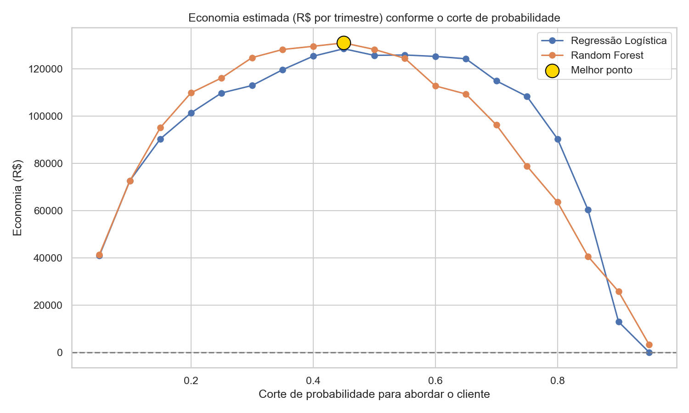
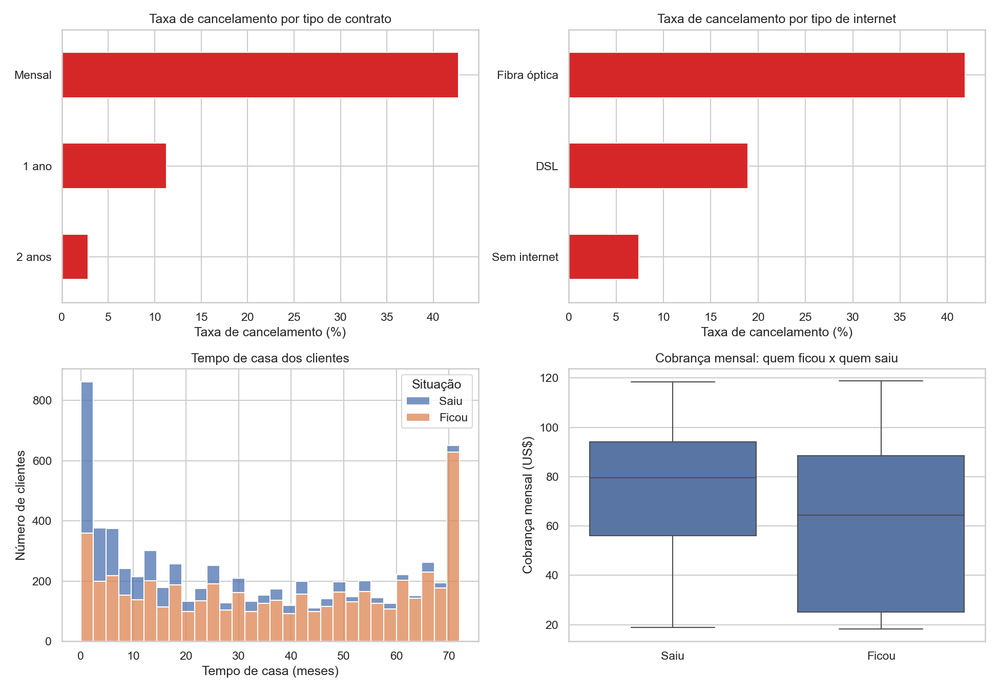
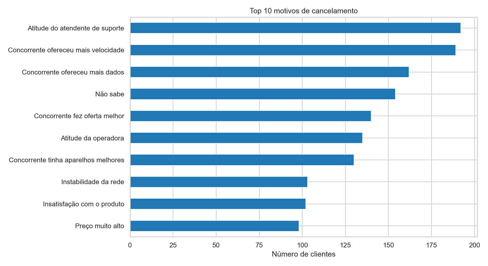
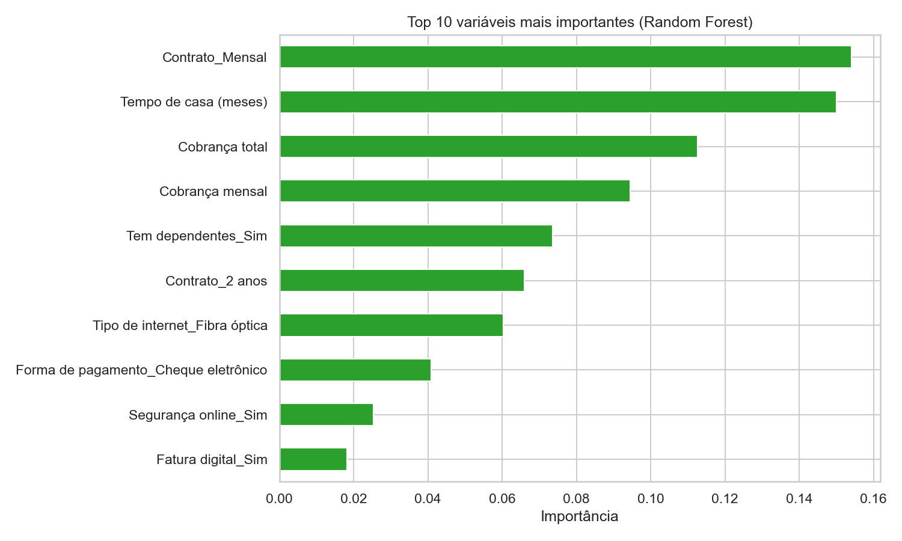
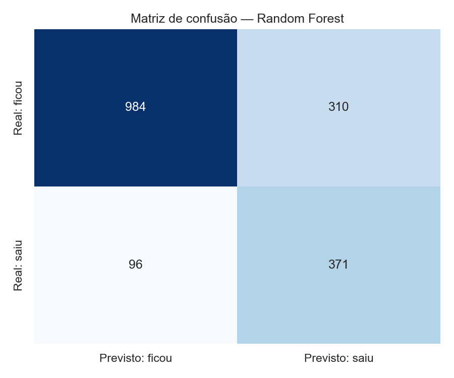

## Previsão de Cancelamento de Clientes (Churn) em Telecom

Projeto de ciência de dados feito por mim para prever quais clientes de uma telecom vão cancelar e calcular quanto dinheiro a empresa pode economizar com isso.

## O problema

Quando um cliente cancela, a empresa perde dinheiro. Mas tentar reter todos os clientes também custa caro. Então a pergunta do projeto é: **quais clientes vale a pena abordar?**

## Os dados

- Dataset **Telco Customer Churn (IBM)**, baixado do **Kaggle**.
- 7.043 clientes e 33 colunas de uma telecom **fictícia** da Califórnia (EUA), de um trimestre.
- Link: https://www.kaggle.com/search?q=Telco+Customer+Churn+IBM
- Os dados são da IBM e foram usados só para estudo e portfólio.

## O que eu fiz

1. Limpei os dados e traduzi os nomes das colunas para português.
2. Removi as colunas `Churn Score`, `CLTV` e `Churn Reason`, porque elas já entregam a resposta ao modelo (vazamento de dados).
3. Fiz a análise exploratória para entender quem cancela.
4. Separei os dados em treino (75%) e teste (25%), mantendo a mesma proporção de cancelamentos nas duas partes.
5. Treinei e comparei dois modelos: Regressão Logística e Random Forest.
6. Calculei quanto dinheiro cada estratégia economiza, testando vários cortes de probabilidade.

## O que descobri

- Contrato **mensal**: cerca de 42% cancelam. Contrato de **2 anos**: cerca de 3%.
- Internet por **fibra óptica**: cerca de 42% cancelam. DSL: cerca de 19%.
- A maioria dos cancelamentos acontece nos **primeiros meses** do cliente.
- Quem cancelou pagava mais por mês.

- Entre os 10 principais motivos, o **preço ficou em último**. Pesam mais o atendimento ruim e as ofertas de concorrentes (velocidade, dados, ofertas e aparelhos melhores).

- As variáveis que mais pesaram no modelo foram o tipo de contrato, o tempo de casa e as cobranças.

## Resultado em dinheiro

Usei estas **suposições minhas** (não são dados reais da empresa):

| Suposição | Valor |
|---|---|
| Custo para abordar 1 cliente | R$ 50 |
| Perda quando 1 cliente cancela | R$ 600 |
| Chance de conseguir reter o cliente | 30% |

**Melhor resultado:** Random Forest com corte de 0,45. A Regressão Logística, que é mais simples, chegou perto.

- Economia estimada: **R$ 130.901 por trimestre**
- Se a empresa abordasse **todos** os clientes: **prejuízo de R$ 15.958 por trimestre**
- O modelo encontra **79%** dos clientes que cancelam (recall de 0,794)
- Dos clientes que o modelo aponta, **55%** realmente cancelariam (precisão de 0,545)

### Acertos e erros do modelo

Nos 1.761 clientes do teste:

- 467 realmente cancelaram. O modelo achou **371** e deixou **96** passarem.
- O modelo abordou **310** clientes que ficariam de qualquer jeito.

Por que uma precisão de 55% é boa? Porque abordar custa R$ 50 e o ganho esperado por cliente que cancelaria é de R$ 180 (30% de R$ 600). A conta já fecha com precisão acima de cerca de 28%. Abordar um cliente a mais sai bem mais barato do que perder um cliente.

## Principais insights

1. **O tipo de contrato é o maior sinal de risco.** Cerca de 42% dos clientes de contrato mensal cancelam, contra cerca de 3% no contrato de 2 anos. É uma diferença de mais de 10 vezes.
2. **A fibra óptica cancela mais que o dobro do DSL.** São cerca de 42% contra cerca de 19%. Os clientes sem internet cancelam menos ainda, cerca de 7%.
3. **O risco é maior no começo.** Os cancelamentos se concentram nos primeiros meses de casa. Quem passa dessa fase tende a ficar.
4. **Quem cancela paga mais.** A cobrança mensal mediana de quem saiu foi de cerca de US$ 80, contra cerca de US$ 65 de quem ficou.
5. **O preço não é o grande vilão.** Entre os 10 principais motivos de saída, "preço muito alto" ficou em último. Cerca de 44% das saídas desse grupo citam o concorrente (velocidade, dados, oferta ou aparelhos melhores), e o atendimento ruim lidera a lista.
6. **Um modelo simples quase empata com um mais complexo.** A Regressão Logística chegou muito perto do Random Forest e até foi melhor nos cortes mais altos, acima de 0,55. Nem sempre o modelo mais sofisticado é necessário.
7. **O corte de probabilidade vale dinheiro.** Com o corte certo (0,45), a economia é de R$ 130.901 por trimestre. Abordando todos os clientes, o resultado é prejuízo de R$ 15.958. E a economia se mantém acima de R$ 100 mil numa faixa grande de cortes, de cerca de 0,2 a 0,65, então a decisão não depende de um número exato.

## O que eu recomendaria à empresa

1. Incentivar a troca do contrato mensal para o anual, principalmente nos primeiros meses.
2. Melhorar a qualidade do atendimento.
3. Investigar a velocidade e a estabilidade da fibra óptica frente à concorrência.

## Limitações

- Os valores em R$ são suposições minhas.
- A base é fictícia e de um único trimestre.
- A importância das variáveis mostra o que pesa no modelo, mas não prova causa e efeito.
- Não fiz validação cruzada nem ajuste fino dos modelos. Seriam os próximos passos.

## Como rodar

1. Instale as bibliotecas: `pip install -r requirements.txt`
2. Baixe a base no Kaggle (link acima) e coloque na pasta `data/`
3. Rode o arquivo `churn_projeto.py` bloco a bloco no VS Code

## Ferramentas

Python, pandas, NumPy, scikit-learn, Matplotlib e Seaborn.

## Autor

Thiago Rosa de Borba — estudante de Ciência de Dados (Uninter)
LinkedIn: https://www.linkedin.com/in/thiagoborba85

git config --global user.name Thiago Borba
git config --global user.email thiagodr88@gmail.com